# Nesting Dolls

⭐️ **GOAL:** Build a mini thread tool where each reply sits inside its
parent the way a smaller doll sits inside a larger one, and every walk down
the thread comes back out with a result.

<!-- omit in toc -->
## ⏱ Agenda

- [[**5m**] ☀️ Warm Up: Watch the Dolls](#5m-️-warm-up-watch-the-dolls)
- [[**10m**] 📚 TT: The Same Motion in Code](#10m--tt-the-same-motion-in-code)
- [[**5m**] 📋 The Ticket](#5m--the-ticket)
- [[**40m**] 💻 Lab 1: Build to the Session Checkpoint](#40m--lab-1-build-to-the-session-checkpoint)
- [[**60m**] 💻 Lab 2: Bring Results Back Out](#60m--lab-2-bring-results-back-out)
- [[**15m**] 💻 Lab 3: Peer Review, Fix, and Recheck](#15m--lab-3-peer-review-fix-and-recheck)
- [Completion Checks](#completion-checks)

Next up: watch the dolls open and close.

## [**5m**] ☀️ Warm Up: Watch the Dolls

<object type="image/svg+xml" data="Lessons/assets/nesting-dolls.svg" width="960" height="500" style="width: 100%; max-width: 960px; height: auto; aspect-ratio: 960 / 500;" aria-label="Nesting dolls animation">
  
</object>

Opening a doll is a recursive call. You look inside.

The small solid doll is the base case. Nothing is inside, so you stop.

Closing the dolls is unwinding. What you found comes back out with you.

The PAUSE chip in the top left stops the loop. If the picture stays still,
read it left to right in time: one closed doll, then the outer shell apart,
then the middle shell apart around a small pink doll, then the shells
coming back together from the inside out.

Next up: the same open-and-close motion in a function someone copied by hand.

## [**10m**] 📚 TT: The Same Motion in Code

All right. A teammate printed a thread by pasting the same loop once per
nesting:

```python
for comment in thread:
    print(comment)
    for reply in comment.replies:
        print(reply)
        for nested in reply.replies:
            print(nested)
```

That is three dolls, and then it stops. Anything nested further never shows
up. Real quick, run the copy that is already in the starter:

```bash
python messy_indent.py
```

The reply about the previous build is in `sample_thread.json` and missing
from that printout.

The refactor is one function. It handles the doll it was handed, then calls
itself on each doll inside. The solid doll is the call with nothing to open.
The lines come back as the calls return. You delete the copied loops.

Next up: four questions, then the thread you are building.

### Four Questions

> **💬 ASK AUDIENCE:** You pull a doll apart and another doll is sitting
> inside. What do you do next?

<details>
<summary>Answer</summary>

The same move, on the smaller doll. Open it. That repeated move is the
recursive call.

</details>

> **💬 ASK AUDIENCE:** You open a doll and it is solid. Nothing is inside.
> What do you do?

<details>
<summary>Answer</summary>

Stop opening. That solid doll is the base case. Close it and hand it back
to the doll you came from.

</details>

> **💬 QUICK CHECK:** Someone hits reply on a comment buried inside other
> comments. What does `add_reply` do before the new comment exists?

<details>
<summary>Answer</summary>

Open each doll until the parent id matches, then nest the new reply in that
doll. The new reply is solid until someone answers it.

</details>

> **💬 ASK AUDIENCE:** The copied loops drop the innermost reply. What is
> the refactor?

<details>
<summary>Answer</summary>

One function. It renders the comment it was handed, then calls itself on
each of that comment's replies. The solid doll is the call that has no
replies to open. The results come back as the dolls close.

</details>

Next up: the ticket.

## [**5m**] 📋 The Ticket

Build the thread tool in
[Code/nesting-dolls-threads](../Code/nesting-dolls-threads/).

People post a top-level comment, or they reply to any comment. You keep the
thread in memory, draw it in the browser, and walk it. The sample file is
the whole data source. The names in it are made up.

Mapping, same as the picture:

- Each reply is a smaller doll inside its parent. A comment can hold
  several replies, side by side.
- Posting a reply opens dolls until you find the parent, then nests a new
  doll inside.
- Rendering and the later walks open dolls until a comment with no replies,
  then close back up with a result.

`comments.py`, the two post routes in `app.py`, and the two templates are
marked `TODO`. The page shell and the forms are already wired.

Next up: Lab 1.

## [**40m**] 💻 Lab 1: Build to the Session Checkpoint

> **✅ DONE WHEN:** the page draws the sample with nesting, a reply to `c3`
> shows inside that comment, and `python -m pytest app_test.py` passes.

1. Work Exercises 1 to 5 below, in order.
1. Run `python -m pytest app_test.py`.
1. Start `python app.py`, open the page, and post a reply to `c3`.
1. Check the Session Checkpoint at the end of this lab.

### Exercise 1: Make a Doll That Can Hold Dolls

A comment needs an id, an author, text, a deleted flag, and a list of
replies. Replies are smaller dolls. No list yet means nothing is inside.

Fill in `Comment.__init__` in `comments.py`.

Next up: open the sample file and build those dolls for real.

### Exercise 2: Open the Sample Until Every Doll Is Real

`load_thread` reads `sample_thread.json`.

The file is shaped like a thread listing. Each child has an id, an author,
a body, a deleted flag, and replies. `body` is the text you store.

`"replies": ""` is a solid doll. Build the comment and stop.

A replies listing means smaller dolls are inside. Open each one the same
way.

**With a partner.** Ten minutes. Trade `load_thread`. Point at their solid
stop, then at the line that opens the next doll. They do the same on yours.

**Solo.** Write down the line number of your solid stop and of the line
that opens the next doll. Then load the sample in a Python shell from the
starter folder and print `thread[0].replies[0].author`. You should see
`cobalt_kite`.

Next up: retire the copied loops.

### Exercise 3: Retire the Copied Loops

`render_lines` returns lines of `author: text`. Indent each reply two
spaces further than its parent.

The lines for the replies come back from the recursive call and sit under
this comment. A solid doll returns its own line only.

`messy_indent.py` stays in the folder as the version you are replacing. The
page uses `render_lines`, not the copied loops.

> **📈 PROTIP:** Write the solid-doll case before the recursive call. If you
> cannot say when you stop opening, leave the call unshipped.

Next up: draw that same walk in the browser.

### Exercise 4: Draw the Thread in the Page

The template does the same open-and-close motion as `render_lines`.

In `templates/_comment.html`, render this comment's author and text. When
the comment is deleted, show the author and the word removed. Then call
`render_comment` on each reply. A comment with no replies is the solid
doll: render it and stop.

In `templates/thread.html`, call `render_comment` for each top-level
comment.

Jinja escapes `{{ comment.text }}`. Use that for author and text.

**With a partner.** One of you reads the macro aloud. The other points at
the solid stop and at the call that opens replies. Swap.

**Solo.** Read your macro aloud, then point at the solid stop and the call
that opens replies. Reload the page and find the previous-build reply,
three levels in.

> **‼️ BE AWARE:** A deleted comment can still hold replies. Those replies
> are real dolls. Your macro still opens them.

Next up: nest a new reply inside the doll it answers.

### Exercise 5: Put a New Reply Inside the Right Doll

`find_by_id` opens each doll until the id matches. A solid doll that does
not match is the stop. A miss returns `None`.

`add_reply` uses that walk, then appends a new solid doll to the parent's
replies. A missing parent raises `LookupError`.

`add_top_level` puts a new doll on the shelf, not inside another doll.
Give every new doll an id that is not already in the thread.

`app.py` loads the sample once, on the first request, and keeps that list
in `THREAD`. The view route and both post routes reuse that same list, so
a new comment is still there after the redirect. Restart the server and
the thread goes back to the sample. Do not reload the sample inside a
route.

Your part in `app.py`: the post routes call `add_top_level` and
`add_reply`, then let the redirect run. A reply to an id that is not in
the thread already comes back as a 404 page. `c3` is a parent id already
in the sample.

**With a partner.** One of you names a parent id. The other says which
dolls `find_by_id` opens to reach it, outermost first.

**Solo.** Use `c6`. Write the dolls `find_by_id` opens to reach it,
outermost first, then check below.

<details>
<summary>Answer for c6</summary>

`c1`, `c2`, `c3`, `c4` (solid, no match, close it and back out), `c5`, then
`c6` matches.

</details>

Next up: check the session checkpoint.

### Session Checkpoint

Stop here and check:

- The page draws the sample with every reply nested under its parent.
- A reply to `c3` shows inside that comment, indented under it.
- `python -m pytest app_test.py` passes. `comments_test.py` still fails
  the tests for Exercises 6 to 10. That is expected.

Stopping here is on track. **Resume point:** Exercise 6.

Next up: bring results back out as the dolls close.

## [**60m**] 💻 Lab 2: Bring Results Back Out

> **✅ DONE WHEN:** `python -m pytest comments_test.py` exits 0.

1. Work Exercises 6 to 10 below, in order.
1. After each one, run `python -m pytest comments_test.py -k` with the
   function name, for example `-k flatten`.
1. Run the whole file at the end.

### Exercise 6: Bring Matching Authors Back Out

`find_by_author` opens a doll, keeps it when the author matches, then does
the same for the dolls inside. Attach what the inner call returns after it
comes back. Parent before the dolls that were inside it.

Next up: the same walk, matching text instead of author.

### Exercise 7: Bring Keyword Mentions Back Out

`find_mentioning` keeps a doll when the keyword appears in its text. Letter
case does not matter. The list comes back as each call returns.

Next up: one list, still in the order you opened them.

### Exercise 8: Lay Every Doll in One Row

`flatten` returns every comment in one flat list. Open a doll, add it to
the list, then extend that same list with what the call on its replies
returns. The nested dolls come back out into one row.

For the sample, the ids come back as `c1`, `c2`, `c3`, `c4`, `c5`, `c6`,
`c7`, `c8`.

> **‼️ WATCH OUT:** `append` drops the whole returned list in as one item,
> so you get a list inside a list. Use `extend`.

Next up: a deleted doll drops out, and the dolls inside it stay.

### Exercise 9: Close Out Deleted Dolls

`collapse_deleted` returns a new thread.

Open the replies first. When the doll is deleted, it does not appear, and
the dolls that came back from inside it take its place. When it is not
deleted, it stays, holding those inner dolls.

> **‼️ BE AWARE:** The deleted comment in the sample still has a reply
> inside it. That reply remains, under the parent that remains.

Next up: the longest chain of dolls from the outside down to a solid center.

### Exercise 10: Follow the Longest Chain to a Solid Doll

`deepest_chain` returns the longest chain of comments from an outermost
doll down to a solid one.

Check every reply, not only the first one. Ask each reply for its own
chain, then keep the longest chain that comes back. When two chains are
the same length, keep the first one you met. Do the same across the
top-level comments. The list starts at the outer comment and ends on the
solid doll. An empty thread returns an empty list.

> **‼️ CAUTION:** The first reply with a doll inside is not always the
> deepest. In the test thread, the short branch comes first and the longer
> branch comes second. A walk that only follows the first branch picks the
> short one.

Next up: a peer review, then a fix.

## [**15m**] 💻 Lab 3: Peer Review, Fix, and Recheck

> **✅ DONE WHEN:** you applied one finding from your reviewer, or wrote one
> line on why no change is needed, and a rerun of `python -m pytest` passes.

1. Swap with someone else.
1. Check only these on their code:
    1. A solid doll stops.
    1. A deleted doll's reply still appears under the parent that remains.
    1. The template calls itself on replies.
    1. `deepest_chain` checks every reply and keeps the longest chain.
1. Write down one finding for them.
1. Take your own finding back. Fix it, or write one line on why no change
   is needed.
1. Rerun `python -m pytest` and tell your reviewer what changed.

**Solo.** Run the same four checks on your own code. Write one finding,
fix it or note why not, then rerun `python -m pytest`.

Next up: the completion checks.

## Completion Checks

Done means all of this is true:

- From `Code/nesting-dolls-threads`, `python app.py` serves the page.
- Posting a top-level comment shows that comment.
- Replying to `c3` shows the reply inside that comment, indented under it.
- `python -m pytest` exits 0. That runs `comments_test.py` and
  `app_test.py`.
- The page uses your recursive template. `messy_indent.py` is not on the
  page.
- The branch is pushed.

Turn-in date: TBD.

Next up: the links below, if you want a second source on macros or on the
dolls themselves.

## Additional Resources

1. [Flask quickstart](https://flask.palletsprojects.com/en/stable/quickstart/)
1. [Jinja macros](https://jinja.palletsprojects.com/en/stable/templates/#macros)
1. [Matryoshka doll](https://en.wikipedia.org/wiki/Matryoshka_doll)
1. [Starter folder](../Code/nesting-dolls-threads/)

<details>
<summary>For Curriculum Authors</summary>

## For Curriculum Authors

The schedule row in the course README is unchanged on purpose.

The animation file is `Lessons/assets/nesting-dolls.svg`. It loops: outer
shell opens, middle shell opens, the small pink doll is the stop, middle
closes, outer closes. The page embeds it with `<object>` so the PAUSE chip
works; the `data` path is relative to the site root. The `` inside is
the fallback and what the GitHub file view shows. Reduced-motion settings
get a still of the solid doll. If a browser will not animate it, the still
description under the picture is the fallback.

There is no solution in this file. `comments.py` and the templates raise or
show a placeholder until the TODOs are replaced.

The Lab 2 time is an estimate for work after the session.

### In Class

1. Play the animation once with the room. Ask the first two teacher-talk
   questions while it is on screen.
1. Run `messy_indent.py` so the room sees the innermost reply missing.
1. Build path: `Comment`, `load_thread`, `render_lines`, the template macro,
   then `add_reply` under `c3`.
1. The walks that bring results back (`find_by_author` through
   `deepest_chain`) are the same open-and-close motion. Leave them for
   after a reply renders.
1. Pair trace after `load_thread`. Peer review after Exercise 10: solid
   stop, deleted reply still present, template calls itself, longest
   chain. Each person applies one finding and reruns the tests.

Common misses: treating `"replies": ""` as a listing, scanning only the
top-level dolls in `find_by_id`, leaving the route `raise` in place,
dropping the reply that was inside a deleted comment, and following only
the first branch in `deepest_chain`.

MVP for the session: the page draws the sample with nesting, and a reply
to `c3` shows inside that comment. That is the Session Checkpoint in Lab 1.

Next up: demo a reply nested under `c3` before the room leaves.

</details>
