# Recursion Nesting Dolls

⭐️ **GOAL:** Use one nesting-doll picture to build a recursive walk: open a
smaller copy of the same task, stop at the solid doll, and bring a result
back out when the dolls close.

<!-- omit in toc -->
## ⏱ Agenda

About two hours. The talk is the dolls. The build is the thread tool.

- [[**10m**] ☀️ Warm Up: Watch the Dolls](#10m-️-warm-up-watch-the-dolls)
- [[**35m**] 📚 TT: One Picture, Then the Same Picture in Code](#35m--tt-one-picture-then-the-same-picture-in-code)
- [[**15m**] 💻 Activity 1: Trace a Walk With a Partner](#15m--activity-1-trace-a-walk-with-a-partner)
- [[**10m**] 🌴 Break](#10m--break)
- [[**40m**] 💻 Activity 2: Build the Thread to the Session Checkpoint](#40m--activity-2-build-the-thread-to-the-session-checkpoint)
- [[**10m**] 💻 Activity 3: Peer Review, Fix, and Recheck](#10m--activity-3-peer-review-fix-and-recheck)
- [Completion Checks](#completion-checks)

Next up: play the animation.

## [**10m**] ☀️ Warm Up: Watch the Dolls

Opening a doll is a recursive call. You do the same job on what is inside.

<object type="image/svg+xml" data="Lessons/assets/nesting-dolls.svg" width="960" height="500" style="width: 100%; max-width: 960px; height: auto; aspect-ratio: 960 / 500;" aria-label="Nesting dolls animation">
  
</object>

The file is [assets/nesting-dolls.svg](./assets/nesting-dolls.svg). It
loops. Use the PAUSE chip in the top left to stop it. If your system is set
to reduce motion, it holds still on the solid doll and the STOP sign.

The small pink doll is the base case. It is solid. You stop opening.

Closing the dolls is the call stack unwinding. Each doll closes and hands
what it found back to the doll it came from.

If the picture stays still, use the frames below. Same three moves.

```text
1. Nested
                 ( RED )

2. Open the outer doll. A call.
        ( RED )            ( RED )
                 ( TEAL )

3. Open the middle doll. Same move, smaller doll.
        ( RED )            ( RED )
            ( TEAL )   ( TEAL )
                 ( PINK )  <- solid, stop

4. Close the middle doll. A return.
        ( RED )            ( RED )
            ( TEAL, holding what was inside )

5. Close the outer doll. The result is back.
                 ( RED, holding what came back )
```

Next up: the talk. Keep the animation in view.

## [**35m**] 📚 TT: One Picture, Then the Same Picture in Code

All right. About 35 minutes. One picture, then the same picture in code.

A recursive function does one slice of the work and hands the rest to a
smaller copy of itself. It's kind of like opening a doll and finding a
smaller doll that needs the same gesture.

Next up: the open.

### Open Means the Same Move on a Smaller Doll

You do not open every doll with a different gesture. You pull this one
apart. If another doll is inside, you pull that one apart the same way.

Real quick, a shipment of nested boxes works the same way. The label you
want might be on this box, or inside a box inside it. One function. The
next call gets the inner box.

```python
def find_in_boxes(box, label):
    """Return the box with this label, opening inner boxes along the way."""
    if box["label"] == label:
        return box
    for inner in box["inside"]:
        found = find_in_boxes(inner, label)
        if found is not None:
            return found
    return None
```

Each box in `box["inside"]` is a smaller doll. A box can hold several, so
the function calls itself on each one in turn. An empty `inside` list
means this box has nothing nested in it.

> **💬 ASK AUDIENCE:** You pull a doll apart and another doll is sitting
> inside. What do you do next?

<details>
<summary>Answer</summary>

The same move, on the smaller doll. Open it. That call is the recursive
call.

</details>

Next up: when you are allowed to stop.

### The Solid Doll Is the Stop

The small pink doll does not open. That is the base case. Write that case
before you write the call. If you cannot say when the opening stops, the
call never comes back.

A folder with no folders inside it is the same stop. An org chart stops
when you reach the person who can approve, or when there is no manager
left to ask.

> **💬 ASK AUDIENCE:** You open a doll and it is solid wood. What do you do?

<details>
<summary>Answer</summary>

Stop opening. Close it. Hand it back to the doll you came from. That
solid doll is the base case.

</details>

Next up: what "hand it back" looks like in code.

### Closing Is the Result Coming Back

Unwinding is the walk back out. The inner call returns. The outer call
attaches that result to its own work and returns too.

It's kind of like unpacking a crate, finding the part, and closing each
crate on the way out with the part in your hand. The call stack is the
line of open crates. The return closes one crate.

> **📈 PROTIP:** Do the recursive call, then use what it returns. The
> useful work of unwinding happens after the call comes back.

The part comes out with the innermost box.

> **💬 ASK AUDIENCE:** Three boxes are open, one inside the next, and the
> part is in the innermost box. What closes first?

<details>
<summary>Answer</summary>

The innermost box. Then the middle one. Then the outer one. Returns
happen in that order: the solid doll closes before the doll that held it.

</details>

Next up: why this is the same move as a refactor.

### One Function Replaces the Copied Steps

A messy version of "list this folder" pastes the same loop once per level
of nesting. It works until someone adds another folder inside, and then
that level is invisible.

```python
def list_names_messy(folder):
    names = [folder["name"]]
    for inner in folder["inside"]:
        names.append(inner["name"])
        for deeper in inner["inside"]:
            names.append(deeper["name"])
    return names
```

The refactor is the doll move. Handle this folder. Call the same function
on each folder inside. A folder with nothing inside returns its own name
and stops.

```python
def list_names(folder):
    """This folder's name, then whatever each inner folder returns."""
    names = [folder["name"]]
    for inner in folder["inside"]:
        names.extend(list_names(inner))
    return names
```

The second version is the same shape at every size. That is the
refactoring parallel. Medium folders and tiny folders share that one
function.

> **‼️ BE AWARE:** Copying the loop "one more time" feels faster than the
> refactor, and it drops whatever is nested further than the copies.
> The single function still sees that inner folder.

Ship the single function.

> **💬 ASK AUDIENCE:** A teammate pasted the folder loop a third time so a
> new nesting would show up. What do you ship instead?

<details>
<summary>Answer</summary>

Delete the copied loops. One function handles the folder it was handed,
then calls itself on each folder in `folder["inside"]`. The empty
`inside` list is the solid doll.

</details>

Next up: three other tickets with that same shape.

### The Same Shape on Other Tickets

You will see this any time a thing holds a smaller copy of itself.

An approval walks up an org chart. The person who can approve is the
solid doll. The name comes back down through the managers you opened.

```python
def approver(person):
    """Walk up until someone can approve, then bring that name back."""
    if person["can_approve"]:
        return person["name"]
    manager = person["manager"]
    if manager is None:
        return None
    return approver(manager)
```

A settings screen with a menu inside a menu is the same walk. Draw this
item, then draw each child item with the same function. A leaf item has
no children. You draw it and stop.

A comment thread is the same shape again. A reply is a smaller doll
inside its parent. A comment can have several replies, so the same call
runs once for each reply. A comment with no replies is solid.

Next up: trace one of these with a partner before you build the thread.

## [**15m**] 💻 Activity 1: Trace a Walk With a Partner

> **✅ DONE WHEN:** your written trace matches the expected order at the
> end of this activity, every call is crossed off, and you can say the
> base case in one sentence.

Three people if you have a trio. Two is enough.

1. Pick `find_in_boxes` or `approver`, and use the input that goes with it.

    ```python
    crate = {"label": "crate", "inside": [
        {"label": "tape", "inside": []},
        {"label": "parts", "inside": [
            {"label": "bolts", "inside": []},
        ]},
    ]}
    find_in_boxes(crate, "bolts")
    ```

    ```python
    cy = {"name": "Cy", "can_approve": True, "manager": None}
    ben = {"name": "Ben", "can_approve": False, "manager": cy}
    ana = {"name": "Ana", "can_approve": False, "manager": ben}
    approver(ana)
    ```

1. One person opens the dolls. Say each call out loud, and name the
   smaller input you pass.
1. The partner tracks the stack. Write the calls that are still open.
   When a call returns, cross it off.
1. Swap. The partner explains your base case in one sentence: the solid
   doll, and what comes back.
1. Check your written trace against the expected order below.

**Solo.** Do both jobs on paper. Write each call as you open it, cross it
off when it returns, and write your base case in one sentence. Then check
it against the expected order.

<details>
<summary>Expected call and return order</summary>

`find_in_boxes(crate, "bolts")`. The tape box is a solid doll with the
wrong label, so that call comes back with `None` and the walk moves on.

```text
call   find_in_boxes(crate)
call     find_in_boxes(tape)
return   None            <- solid, wrong label
call     find_in_boxes(parts)
call       find_in_boxes(bolts)
return     bolts box     <- label matches, stop
return   bolts box       <- parts hands it back
return bolts box         <- crate hands it back
```

`approver(ana)`:

```text
call   approver(ana)
call     approver(ben)
call       approver(cy)
return     "Cy"          <- can approve, stop
return   "Cy"
return "Cy"
```

</details>

> **‼️ BE AWARE:** If your partner's trace never crosses a call off, the
> base case is missing. Stop and name the solid doll before you add
> another call.

Next up: a break, then the thread ticket.

## [**10m**] 🌴 Break

Leave the animation up.

Next up: build the thread tool.

## [**40m**] 💻 Activity 2: Build the Thread to the Session Checkpoint

> **✅ DONE WHEN:** the page draws the sample with nesting, a reply to `c3`
> shows inside that comment, and `python -m pytest app_test.py` passes.

1. Open [Code/nesting-dolls-threads](../Code/nesting-dolls-threads/) and
   follow its install steps.
1. Run `python messy_indent.py` once. The innermost reply never appears.
1. Work Exercises 1 to 5 in [Nesting Dolls](./nesting_dolls_threads.md).
1. Run `python -m pytest app_test.py`. Then start `python app.py` and post
   a reply to `c3`.

Each reply is a smaller doll inside its parent. Posting a reply opens
dolls until that parent, then nests a new one. Drawing the thread and the
later walks open until a comment with no replies, then close back up with
a result.

The page shell, the forms, and the sample thread are already there.
`comments.py`, the two post routes in `app.py`, and the recursive template
are marked `TODO`. The sample names are made up. The file is the whole
data source.

`messy_indent.py` is the copied-loop version. Your `render_lines` retires
that file from the page.

**Stopping here is on track.** The session checkpoint is the page plus the
reply under `c3`. Next time, pick up at Exercise 6 in the project file.
Exercises 6 to 10 are the same open-and-close walk.

Next up: a peer review, then a fix.

## [**10m**] 💻 Activity 3: Peer Review, Fix, and Recheck

> **✅ DONE WHEN:** you applied one finding from your reviewer, or wrote one
> line on why no change is needed, then reran `python -m pytest app_test.py`
> and told your reviewer the result.

1. Swap branches with someone who did not trace with you.
1. Check only these on their code:
    1. A comment with no replies stops.
    1. A result from inside is attached after the recursive call returns.
    1. The template calls itself on replies.
    1. A deleted comment's reply is still there, under the parent that
       remains.
1. Say the base case out loud on their code. They say yours.
1. Take one finding back to your own branch. Fix it, or write one line on
   why no change is needed.
1. Rerun `python -m pytest app_test.py` and reload the page. Tell your
   reviewer what changed and what the rerun showed.

**Solo.** Run the same four checks on your own branch. Write one finding,
fix it or note why not, then rerun the same test.

Next up: the bar for the full project.

## Completion Checks

This is the bar for the full project. The session checkpoint is in
Activity 2.

Done means all of this is true:

- From `Code/nesting-dolls-threads`, `python app.py` serves the page.
- A new top-level comment shows up.
- A reply to `c3` shows inside that comment, indented under it.
- `python -m pytest` exits 0. That runs `comments_test.py` and
  `app_test.py`.
- The page uses the recursive template.
- The branch is pushed.

Turn-in date: TBD.

Next up: a few links if you want the same idea from another source.

## Additional Resources

1. [Nesting dolls animation](./assets/nesting-dolls.svg)
1. [Thread project](./nesting_dolls_threads.md)
1. [Starter folder](../Code/nesting-dolls-threads/)
1. [Flask quickstart](https://flask.palletsprojects.com/en/stable/quickstart/)
1. [Matryoshka doll](https://en.wikipedia.org/wiki/Matryoshka_doll)

<details>
<summary>For Curriculum Authors</summary>

## For Curriculum Authors

The course README schedule is unchanged on purpose.

This page is the session plan. The build ticket and the exercise list
live in `Lessons/nesting_dolls_threads.md`. The code shell is
`Code/nesting-dolls-threads/`. Do not paste a solution for `comments.py`
into either page.

The animation is `Lessons/assets/nesting-dolls.svg`. The page embeds it
with `<object>` so the PAUSE chip works. The `data` path is relative to the
site root because the course site does not rewrite raw HTML paths. The
`` inside is the fallback, and it is what the GitHub file view shows.
An `` plays the loop but cannot pause it. The ASCII frames in the
Warm Up are the fallback when a browser will not animate an SVG.

`find_in_boxes`, `list_names`, and `approver` are talk samples. They are
not the thread starter. If the room starts porting them line for line
into `comments.py`, point them back at the TODOs and the sample JSON
shape (`"replies": ""` is the solid doll).

### In Class

1. 10 min. Play the animation with the room. Read frames 1 to 3 out loud
   if it will not move. Ask the first audience question while it is open.
1. 35 min. Teacher talk in this order: open, solid stop, close and
   return, the folder refactor, then approver and menus as extra
   tickets. Ask the four questions where they sit in the talk. Stay on
   the boxes and the folder. Leave the thread code for the build.
1. 15 min. Pair trace on `find_in_boxes` or `approver` with the supplied
   input. Visit pairs. Listen for a base case and for calls getting
   crossed off.
1. 10 min. Break. Leave the animation up.
1. 40 min. Starter. Milestone for the room: the page draws the sample
   with nesting, and a reply to `c3` sits inside that comment. That is the
   Session Checkpoint in the project file. The later walks are the same
   open-and-close motion.
1. 10 min. Peer review, one fix, and a rerun.

Common misses: no base case, so the trace never returns. Copying one more
loop into `messy_indent.py` instead of replacing it. Scanning only the
top-level comments in `find_by_id`. Dropping the reply that was inside a
deleted comment.

Next up: demo a reply nested under `c3` before people leave.

</details>
